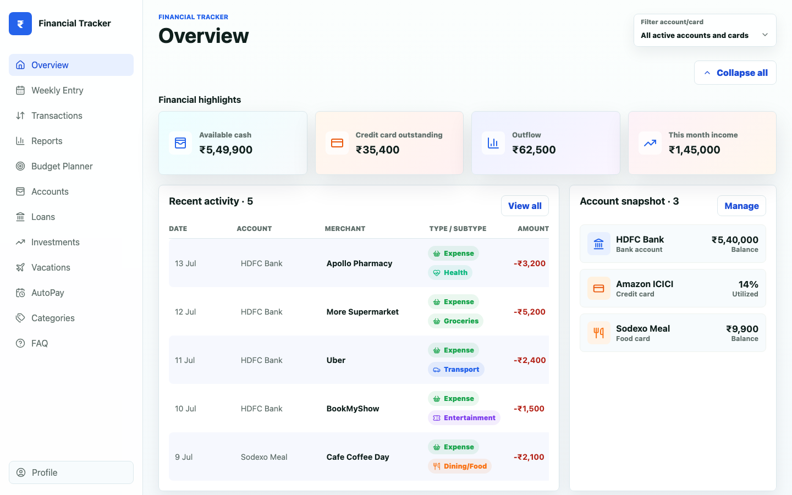

# Financial Tracker

A personal finance tracker for one household's real money: accounts and cards, weekly entry, budgets, loans
and EMIs, investments that pay you back, subscriptions that pay themselves, and reports that agree with each
other.

It runs two ways from the same code. **Hosted**, so it opens on a phone like any other site: the app is
deployed to Vercel and keeps its data in a hosted Postgres database, behind a sign-in. **On your own machine**,
where it starts an in-process Postgres under `data/` and reaches nothing outside the project. Which one you get
is decided by a single environment variable, `DATABASE_URL`.



> The screenshot above uses fake demo data for illustration.

## Features

- Overview dashboard with financial highlights, recent activity, spending mix, net worth, asset allocation,
  this month's cashflow, emergency-fund runway, and budget guardrails
- Weekly transaction entry across bank accounts, credit cards, and food cards
- Full transaction ledger grouped by day, each heading carrying that day's count and net, with search
  (merchant, SubType or amount), type/subtype/date filters, an "uncategorized only" view, CSV export of the
  current filters, undo after delete, one-tap "add again", and multi-select delete
- Refunds tied to the purchase they came from (the Refund button on a purchase), so money back reduces that
  purchase's category instead of counting as income
- Self transfers between your own bank accounts, which move both balances without counting as spending
- Reports with inflow/outflow/savings, an outflow mix and per-Type breakdowns, week-/month-/year-on-year
  trends, and a budget-vs-actual chart per expense SubType
- Budget Planner for monthly expense-SubType budgets, usage percentage, projected spend, and early warning states;
  a new month can copy last month's budget in one tap
- Investment holdings — stocks, mutual funds, gold, land, property, PF, fixed deposits, bonds and Post Office
  schemes — grouped by type with invested/current/net-gain, optionally sub-grouped by the year or month you
  invested, feeding the Overview's asset-allocation donut
- Holdings that pay you back — Post Office schemes, fixed deposits and bonds — credit their bank on schedule
  until their last paying day, showing interest earned rather than a paper gain, and counted once in net worth
- Mutual funds bought as a SIP take their own monthly instalment from a chosen bank when the balance covers it
- Vacations — tag any expense to a trip and it still counts as a normal expense while also rolling up under the
  trip, with a per-SubType breakdown and an optional trip budget
- Loans and card EMIs with a suggested EMI, reducing-balance interest/principal split, months left and closure
  month worked out from the outstanding balance (a regular final EMI closes the loan). The interest paid before
  you started recording EMIs is read from the loan's own schedule, walked until it has repaid the gap between
  the original principal and the balance you entered
- Credit-card EMIs settled as part of the card bill: paying the card asks which EMIs the payment covered, and
  updates the card and each instalment together
- AutoPay subscriptions that take their own payment from the bank you attach, only when the balance covers it,
  and stay listed under Upcoming payments when it doesn't
- Account, credit-card and food-card tracking with per-account minimum balances; an account's name, opening
  balance and card limit can be corrected later to match your bank statement
- Custom Types and SubTypes
- Built-in FAQ explaining how each figure is calculated
- Import transactions from a spreadsheet; new users can type new accounts, Types, and SubTypes directly in the
  template
- Local profile and display settings
- Automatic local backups (every 30 minutes and on shutdown)

## How it works

- **Frontend:** React 19 + Vite
- **Backend:** Node.js + Fastify
- **Database:** Postgres, either hosted (`DATABASE_URL`, Supabase in production) or in process under `data/`
  when that variable is unset. One schema file serves both, so what the tests meet is the engine production runs.

### Accounts and privacy

There is no sign-up. An account exists only because the owner made one:

```bash
node server/account.ts create someone@example.com
```

Every row in every table carries whose it is, and the database enforces that with row-level security rather
than trusting the application to remember — two people on the same deployment cannot see each other's money.
The local database files and the `backups/` folder are excluded from git, so only source code is
version-controlled.

Account deletion is history-safe:

- Accounts with no linked transactions are deleted permanently.
- Accounts that already have linked transactions are hidden from active screens so historical transactions and
  reports can still be calculated correctly.

The profile section only allows saving once name, email, and age are filled with valid values.

## How money is counted

One rule decides what counts as money coming in versus going out, and both the Overview and Reports pages use it, so
their figures always agree:

- **Inflow** — Income, plus any refund that isn't tied to a purchase.
- **Outflow** — everything else: Expense, Loan, Investment, Transfer, and anything uncategorized.
- **Savings** — Inflow minus Outflow.

**Self transfers and credit-card payments are excluded from both sides.** Moving money from one of your own bank
accounts to another is neither income nor spending. A credit-card payment is the same idea: the spending was already
counted when you charged the card, so counting the bill payment again would double-count it. Both still show in your
transaction list and adjust the balances involved — a card payment lowers your bank balance and clears the card's
outstanding.

To record a self transfer, add a transaction on the account the money leaves, choose Type = Transfer and
SubType = Self transfer, then pick the receiving account.

A **refund tied to its purchase** (recorded with the Refund button) isn't inflow at all: it reduces the purchase's
SubType, so returning ₹2,000 of a ₹5,499 Shopping order leaves ₹3,499 of Shopping. It also lowers the card's
outstanding when the purchase was on a card. Refunds can never add up to more than was paid.

The **spending mix** on the Overview leaves out money you put into investments (it's saved, not spent). Outflow still
includes it, and the cashflow panel shows how much of the outflow was invested.

**Budget projections** estimate month-end spend for each line. Once a line has at least two recent months of history,
the estimate is what you've spent so far plus what that line typically adds in the rest of the month. Rent paid on the
3rd therefore projects to the rent, not double it. Without that history it follows your pace so far, and in the first
days of a month it just shows what you've spent.

The **emergency-fund runway** divides your liquid cash by your average monthly outflow over the last three months.

## Requirements

- [Node.js](https://nodejs.org/) 24 or later
- [pnpm](https://pnpm.io/installation) (`npm install -g pnpm`)

## Install and run (single machine)

```bash
# 1. Clone the repository
git clone https://github.com/rameshnaidu-github/financial-tracker.git
cd financial-tracker

# 2. Install dependencies
pnpm install

# 3. Build the app
pnpm build

# 4. Start it
pnpm start
```

The app will be available at **http://127.0.0.1:4000**.
To deliberately allow other devices on your network to reach it, start with `HOST=0.0.0.0 pnpm start` and use that
only on a trusted network.

On first run the app starts its own Postgres in process and keeps it under `data/` — no database to install. It
then needs one account before anyone can sign in:

```bash
node server/account.ts create you@example.com
```

These steps work the same on **macOS, Windows, and Linux** — install Node.js and pnpm for your platform and run the
commands above from a terminal (on Windows, use PowerShell or Command Prompt). The optional `scripts/start.sh` /
`scripts/stop.sh` helpers are macOS/Linux-only; on Windows just use `pnpm start` and stop with `Ctrl+C`.

### Development mode

To run the frontend and backend with hot-reload while making changes:

```bash
pnpm dev
```

## Stopping the app

Press `Ctrl+C` in the terminal where it's running. This triggers a graceful shutdown backup before exiting.

## Backups

These apply to a database the app keeps on disk. When `DATABASE_URL` points at a hosted Postgres there is no file
to copy and the app takes no backups of its own — that database's host keeps them.

Locally, backups are written to the `backups/` folder (excluded from git):

- Every 30 minutes while the server is running
- On graceful shutdown (`Ctrl+C`)

The newest 5 backups are always kept, plus the newest backup of each of the last 7 days, so a bad afternoon can't
push every good copy out. If you run a second copy against another database with `FINANCE_DB_PATH`, its backups go
to a `backups/` folder beside that database (or to `FINANCE_BACKUP_DIR` if set), never into this app's `backups/`.

Either way, the Transactions page exports everything the current filters show, which is a copy you hold yourself.

## Deploying it

The hosted build runs on Vercel: `vercel.json` builds the client with Vite and serves the API from a single
function in `api/`. Set `DATABASE_URL` for **every** environment you deploy — Production, Preview and
Development each read their own — because a hosted runtime has no disk to fall back to, and the app refuses to
start rather than quietly accept transactions it would lose. The schema applies itself at boot, so a deploy that
adds a column needs no migration step.

## For a friend/second machine

Two ways to share it, and they are not the same.

**Their own copy.** Cloning this repo on another computer and running the steps above creates a brand-new, empty
database on that machine. Nothing is shared or synced with any other install.

**An account on yours.** Create one with `node server/account.ts create them@example.com`. They sign in to the
same deployment and see only their own rows. Never hand anyone the `DATABASE_URL` itself: the application
connects as a role that bypasses row-level security, so that string reads and writes everyone's money.
